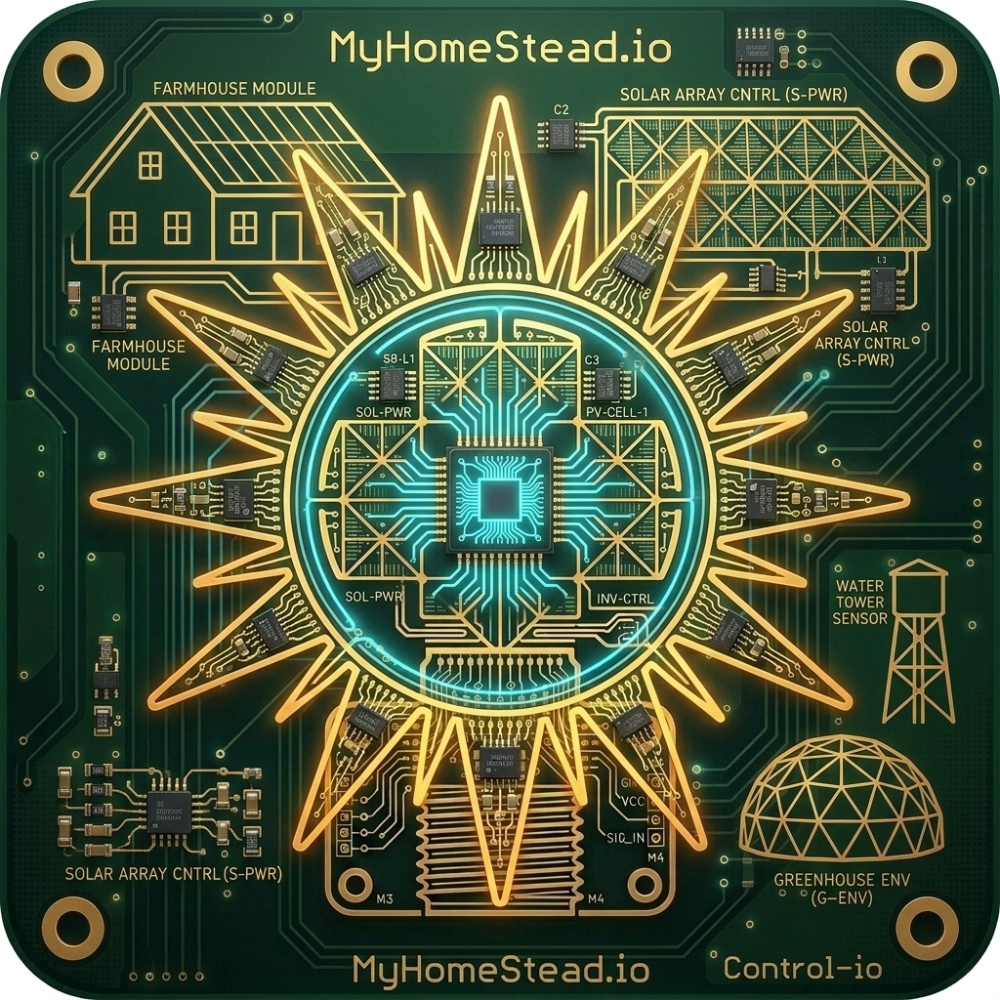

# SprinklerController-io

[](https://www.home-assistant.io/)
[](https://opensource.org/licenses/MIT)


> **Intelligent, multi-zone sprinkler & irrigation management system for Home Assistant with distributed ESP32 edge microcontroller support.**

<p align="center">
  
</p>

---

## ⚡ Overview

**SprinklerController-io** turns your Home Assistant instance into an intelligent, weather-adaptive irrigation management system. It pairs Home Assistant's scheduling with edge-native **ESP32 microcontrollers** (over Wi-Fi, Ethernet, and Bluetooth) to control 24VAC solenoid valves, booster pumps, pulse flow meters, and soil moisture sensors with complete hardware fail-safe protection.

```
                      +------------------------------------------+
                      |          Home Assistant Core             |
                      |  (Supervisor / Weather / Entities / DB)  |
                      +--------------------+---------------------+
                                           |
                                  Ingress / REST / WS
                                           |
                      +--------------------v---------------------+
                      |       SprinklerController-io             |
                      |            (HA Add-on)                   |
                      |  - Ingress Web UI (Dashboard & Planner)  |
                      |  - Evapotranspiration (ET) & Rain Delay  |
                      |  - Cycle & Soak Sequencer                |
                      |  - GPM & Hydraulic Budget Manager        |
                      +--------------------+---------------------+
                                           |
                              Home Assistant Native API / MQTT
                                           |
         +---------------------------------+---------------------------------+
         |                                 |                                 |
+--------v--------+               +--------v--------+               +--------v--------+
|  ESP32 Node 1   |               |  ESP32 Node 2   |               |  ESP32 Node 3   |
| (Wired Ethernet)|               | (Wi-Fi 8-Relay) |               | (BLE & Sensors) |
|   WT32-ETH01    |               |  NodeMCU-32S    |               |   ESP32-WROOM   |
+--------+--------+               +--------+--------+               +--------+--------+
         |                                 |                                 |
 24VAC Solenoids                   24VAC Solenoids                   Soil Moisture (BLE)
 Main Valve & Flow                 Lawn & Garden                     Rain Sensor & PSI
```

---

## 🚀 Key Features

- **🌐 ESP32 Microcontroller Architecture**:
  - **Wired Ethernet / PoE (WT32-ETH01, Olimex PoE)**: Rock-solid, interference-free connection for outdoor valve boxes.
  - **Wi-Fi Multi-Relay Nodes**: Flexible retrofits for 4/8/16-channel 24VAC sprinkler valves.
  - **Bluetooth Low Energy (BLE)**: Active BLE tracking for battery-powered soil moisture probes (e.g., Xiaomi Mi Flora).
- **🛡️ Hardware Edge Fail-Safes**:
  - Auto-off watchdog timers in ESP32 firmware shut off valves even if Home Assistant or Wi-Fi goes offline mid-cycle.
  - Hardware mutual exclusion interlocks prevent simultaneous valve opening beyond water supply pressure.
- **💧 Cycle & Soak Scheduling**:
  - Automatically pulses watering with soak delays to prevent water runoff on slopes and clay soils.
- **🌤️ Weather & Water Budgeting**:
  - Evapotranspiration (ET) calculations adjust runtimes dynamically.
  - Automatic rain delays and freeze lockouts (< 3°C / 37°F).
- **📊 Real-time Flow Monitoring & Leak Alarms**:
  - Pulse-counter flow rate (GPM) tracking and unscheduled flow leak detection.
- **🖥️ Home Assistant Ingress UI**:
  - Responsive web dashboard embedded directly in the Home Assistant sidebar.

---

## 📦 Installation in Home Assistant

1. In Home Assistant, navigate to **Settings** -> **Add-ons** -> **Add-on Store**.
2. Click the three dots (top right) -> **Repositories**.
3. Add this repository URL:
   ```text
   https://github.com/Paradigm-Paradox/SprinklerController-io
   ```
4. Find **SprinklerController-io** and click **Install**.
5. Configure your zones and sensors, start the add-on, and open the Web UI!

---

## 📁 Repository Structure

```text
├── sprinkler_controller/
│   ├── config.yaml              # Home Assistant add-on configuration & options schema
│   ├── Dockerfile               # Multi-arch container definition
│   ├── build.yaml               # Multi-architecture builds (aarch64, amd64, armv7)
│   ├── DOCS.md                  # Comprehensive user and installation documentation
│   ├── CHANGELOG.md             # Version history
│   ├── DESIGN.md                # System architecture & hardware specs
│   ├── templates/esphome/       # Ready-to-flash ESPHome YAML templates (Wi-Fi & Ethernet)
│   └── rootfs/app/              # FastAPI backend & Ingress dashboard
├── icon.png                     # Official vintage PCB sprinkler icon
├── repository.yaml              # Add-on repository catalog manifest
└── README.md
```
